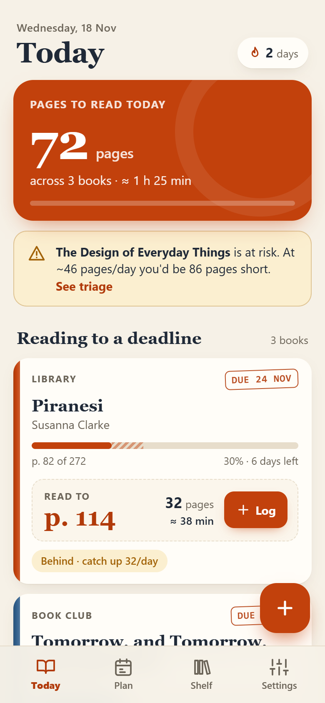
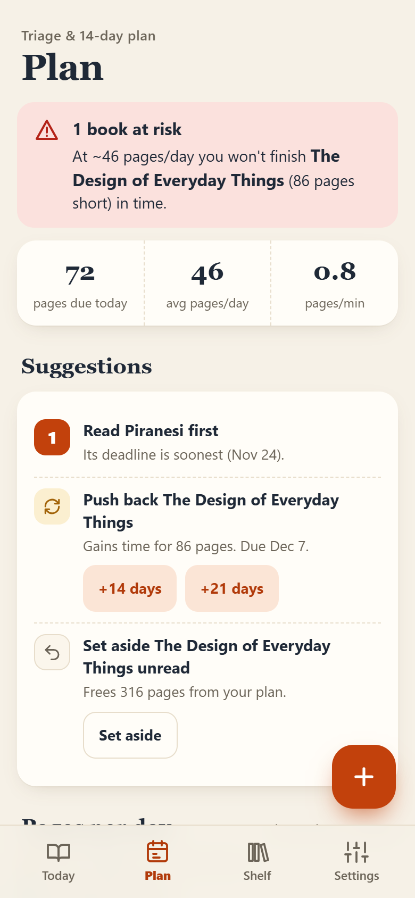
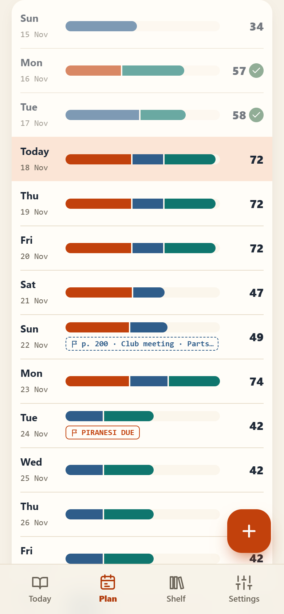
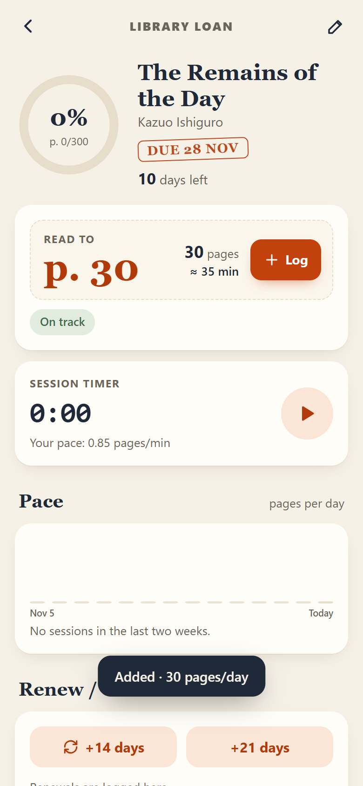
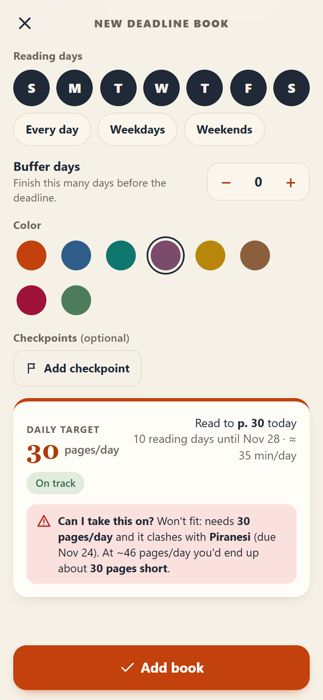
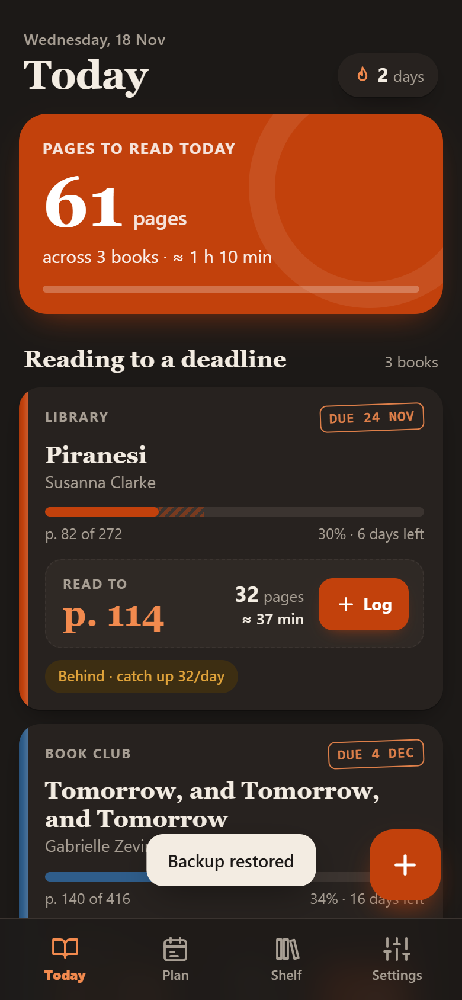

# Readline

**Finish every library loan and book-club pick on time: your daily page target, recalculated as you read.**

## The problem

If you read to a deadline, like a library due date, a book-club meeting or a class assignment, you end up working out pages per day by hand. Then you redo the sum every time you skip a day or fall behind. With several loans at once it is hard to tell whether you can finish all of them. People over-borrow, worry about fines, or don't start a book because they doubt they will finish it in time.

Evidence:

- [StoryGraph feature request](https://roadmap.thestorygraph.com/requests-ideas/posts/pages-for-book-club-calculator): readers want a "pages per day to finish by date / by book-club meeting" calculator. Today they "do this by hand and recalculate often", and another commenter wants the same for library due dates.
- [Modern Mrs Darcy discussion](https://modernmrsdarcy.com/library-due-dates-deadlines/): readers say they forget due dates, borrow more than they can finish in two weeks, feel "on edge" when a book is overdue, and skip books they doubt they can finish.
- [Bookmory reviews](https://justuseapp.com/en/app/1515533482/bookmory-book-tracker/reviews): premium costs $30/yr, most features are paywalled or need ads, and reviewers worry about tracking.
- [Bookly reviews](https://apps.apple.com/us/app/id1085047737): streaks are paywalled and the free tier caps you at 10 books.
- [Omni reading-time calculator](https://www.omnicalculator.com/reading/reading-time): a one-off calculator that doesn't remember your books, your progress or your deadlines.

Readline is a private, ad-free, offline planner built around deadlines. It handles several books at once.

## Features

- **Deadline books**: title, author, page range (e.g. pp. 1–210 for a club section), current page, due date, and a type (Library loan / Book club / Class / Personal goal). Each book can have its own reading days (e.g. weekdays only) and **buffer days** so you finish early.
- **Live daily target**: shows "Read to p. X" and the pages left today. The target is remaining pages ÷ remaining reading days, and it recalculates when you log progress or miss a day. Each book gets a status chip: *On track*, *Ahead by N pages*, *Behind · catch up N/day*, or *Impossible at your pace*.
- **Book-club checkpoints**: set "p. 120 by Thursday's meeting" and the daily target aims at the checkpoint first, then the end of the book.
- **Quick logging**: type the page you stopped at, or tap +10 / +25 / Target / The end. A built-in **session timer** learns your pages per minute, so targets show time estimates such as "32 pages ≈ 38 min".
- **Triage across all books**: simulates your recent pace with earliest-deadline-first scheduling. It names the books at risk and suggests what to do: *read X first*, *renew Y* (+14 / +21 days with one tap, logged as a renewal), or *return Z unread*.
- **"Can I take this on?"**: enter a new book's pages and due date before you borrow it, and you get a "fits" or "won't fit" verdict that names the conflict. The same check runs live in the Add Book form.
- **14-day plan**: one row per day with colour-coded pages per book. It shows the last 3 days of actual reading, deadline and checkpoint flags, ticks on days you hit your target, and overdue warnings.
- **Streaks and celebrations**: a gentle daily streak, and a vibration plus toast when you finish a book.
- **Shelf**: finished, returned and abandoned books with on-time / late badges. Stats cover books finished, % on time (returned books don't count), pages this month and average pages per reading day. You can share a text summary through the Android share sheet.
- **Settings**: default reading days, buffer and loan length; System / Light / Dark theme (warm paper or espresso); JSON export (copy or share) and import; reset; sample data.
- Sample books are loaded on first launch, so the app is never empty. Everything is stored on the device.

## Screenshots

| Today | Triage | 14-day plan |
|---|---|---|
|  |  |  |

| Book detail | Add book (live preview) | Dark mode |
|---|---|---|
|  |  |  |

## Install

Download `app-release.apk` from this repository's **GitHub Releases** page and open it on your Android phone. You may need to allow installs from unknown sources.

## Tech notes

- Plain HTML/CSS/JS in `app/src/main/assets/www/` (`core.js` does the date and reading math with no DOM; `app.js` is the UI). It runs inside a thin Android WebView shell (`MainActivity.java`).
- Fully offline: no network requests, CDNs or web fonts. It uses system serif, sans and monospace fonts.
- State lives in `localStorage` under `readline.v1`, using the data model from the spec. Pace, targets and statuses are calculated from the data each time rather than stored.
- Reading days run from today up to (but not including) the deadline minus buffer days, so a 300-page book due in 10 days gives 30 pages/day.
- The native bridge (`Android.toast`, `vibrate`, `share`) is detected before use. The hardware back button closes dialogs, sheets and pages in order, then returns to the Today tab.
- QA: `_qa/scenario.js` is a Playwright walkthrough of the spec's test scenarios, including the 30 → 28 pages/day recalculation, the "won't fit" verdict, renewals, finishing, and persisting data through a reload and an export/import round trip.

Built autonomously by the Auto Builder agent swarm (Claude Code).
